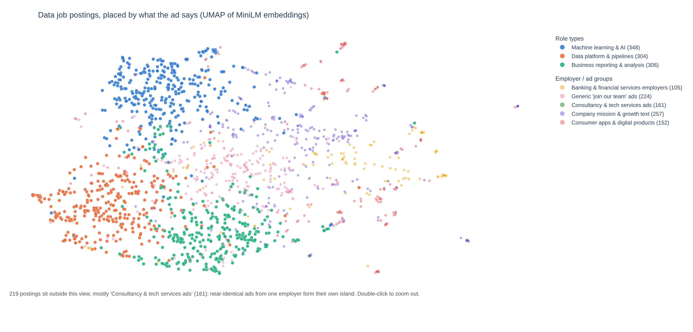

# Data Role Explorer

**What kinds of data jobs are there really, and do the job titles tell you?**

I clustered 1,857 UK data job ads by what they say about the work, with every
job title blanked out, then compared the groups with the titles employers use.
The results are in a Streamlit app where you can explore the market and match
your own CV to a role type.

**Live app: https://watcavv789g4nxchjiehc7.streamlit.app/**



## The question

Ads for data jobs use a handful of titles (data scientist, data analyst, data
engineer, ML engineer, BI analyst), but the same title can mean very different
work from one employer to the next. So the project asks:

1. What distinct types of data roles exist, judged by the work described?
2. What skills define each type?
3. How well do those types line up with the official job titles?

## Key findings

<!-- FINDINGS: to be written once the highlights are agreed -->

## Data

- **Source:** the [Adzuna API](https://developer.adzuna.com/), an official job
  search API (no scraping). UK ads, collected on 2026-10-24.
- **Search terms:** data scientist, data analyst, data engineer, machine
  learning engineer, ML engineer, business intelligence analyst, BI analyst
  (up to 500 ads each).
- **Size:** 2,454 rows collected, 1,995 unique jobs after removing duplicates
  and reposts, and 1,857 in scope (titles that name a data role, excluding
  training-course ads).
- **What an ad contains:** title, company, location, advertised salary (when
  given) and a **500-character snippet** of the description. The snippet
  length shapes most of the results and limitations below.
- **Snapshots:** every run is saved with its date (`data/raw/adzuna_gb_2026-10-24.jsonl`)
  alongside a `.meta.json` describing it, so the analysis can be rerun on the
  exact same data.

## Method

```
collect.py ─▶ clean.py ─▶ skills.py ─▶ embed.py ─▶ cluster.py ─▶ projection.py ─▶ app/
Adzuna API    dedupe,      dictionary   MiniLM on    K-means     UMAP 2-D map     Streamlit
              titles,      matching     masked text  k = 8
              salaries
```

Each step reads the previous step's dated file in `data/` and writes its own,
so the deployed app only reads small precomputed files. The rules and
settings for every step, with the reason for each, are in
[docs/METHOD.md](docs/METHOD.md). The decisions that matter most:

| Decision | Choice | Why |
|---|---|---|
| Text to cluster | Description with role names masked ("data engineer", "analyst", "scientist", ...) and employer boilerplate removed | With titles left in, the clusters just learn the title back, which makes comparing them with titles circular |
| Features | Sentence embeddings (`all-MiniLM-L6-v2`, 384-d) | On masked text, TF-IDF found only one work-based group (ML); embeddings found three. The larger `all-mpnet-base-v2` gave nearly the same clusters in 6x the time with a model nearly 5x the size |
| Algorithm | K-means | HDBSCAN was unstable here: it flipped between one giant cluster of 1,600+ ads and dozens of tiny ones with 25 to 44% of ads labelled noise. K-means gives stable groups and puts every ad somewhere, which "match me" needs |
| Number of clusters | k = 8 | Silhouette scores were low for every k (0.12 to 0.16), so they could not choose k alone. At k = 5 analysis and data engineering merge into one cluster; k = 8 keeps them apart. Clusters were then read and named by hand |
| Evaluation | Silhouette, plus reading each cluster's top terms, skills and sample ads | Short text gives low silhouettes, so manual inspection carried most of the weight |
| Comparing with titles | Adjusted Rand index and a title-by-cluster table | Shows how much the work-based groups agree with the titles |
| Skills | A curated dictionary of 99 skills with synonyms ("sklearn" = "scikit-learn") | Transparent: every match can be checked by eye and the list is easy to change |
| Map | UMAP to 2-D, only for drawing | The clusters come from the full 384-d space; the map never changes a label |

Of the eight clusters, three describe a type of work and are reported as
**role types**: ML & AI, data platform & pipelines, and reporting & analysis.
The other five group ads by employer or ad template (banking employers, one
consultancy's repeated template, consumer-app companies, "people and purpose"
mission text, generic "join our team" text). They are kept in the app and
labelled as employer groups, but they are not treated as roles.

### Match me

The app's "match me" page takes pasted skills, CV text or a PDF CV and uses a
hybrid of the two tools above:

1. **Which role type:** role names are blanked out of the text (as in the
   ads), the text is embedded with the same MiniLM model in ~500-character
   pieces, and the closest of the three role-type centres wins. If the top
   two are within 0.03 it is reported as a close call.
2. **What to add:** the skill dictionary finds the skills in the text and
   lists the matched role's common skills that are missing, most asked-for
   first.

The language model is better at judging the overall kind of work; the
dictionary is better at naming exact skills. Only the three role types are
matched, because matching someone to an employer group says nothing about
their work.

## Limitations

- **Short snippets.** Adzuna returns only the first 500 characters of each
  description, which is mostly the title and the employer's blurb. That is why
  five of the eight clusters are about the employer rather than the job, and
  why 58% of ads mention no skill from the dictionary. Full descriptions
  would very likely give cleaner and more role types.
- **One country, one day.** UK ads from a single snapshot on 2026-10-24. The
  picture may differ in other countries or months.
- **The search terms shape the sample.** Only ads matching the seven search
  terms were collected, so roles under other names (for example "analytics
  engineer", with 4 ads) are barely represented.
- **Salaries are sparse.** Only about a third of in-scope ads give an
  advertised salary. Adzuna's own predicted salaries are kept in a separate
  column and never mixed with advertised ones.
- **Weak cluster structure.** Silhouette scores are low (0.14 for the final
  setting), meaning the groups overlap. The role types are a useful summary,
  not sharp boundaries.
- **The skill dictionary is hand-made.** It finds only the 99 skills it
  lists, and keyword matching can miss phrasings it does not know.

## How to run

Built and tested with Python 3.13. The collection step needs free Adzuna API keys; every
later step runs on the snapshot already in `data/`.

```bash
python -m venv .venv && source .venv/bin/activate
pip install -r requirements.txt

# Optional: collect a fresh snapshot (needs keys)
cp .env.example .env            # then paste your Adzuna App ID and App Key
python -m src.collect           # UK, 10 pages per search term

# Rebuild every step from the newest snapshot
python -m src.clean
python -m src.skills
python -m src.embed             # downloads the MiniLM and mpnet models from huggingface.co
python -m src.cluster compare   # the full comparison table
python -m src.cluster final features_emb-all-minilm-l6-v2_masked_gb_2026-10-24.npz --kmeans 8
python -m src.projection

# Run the app locally
streamlit run app/streamlit_app.py

# Tests (no keys or network needed)
python -m pytest
```

Every step uses seed 42 and all package versions are pinned in
`requirements.txt`, so rerunning on the same snapshot gives the same clusters
and the same map. API keys are read from `.env` (or Streamlit secrets), which
git ignores.

### Deploying

The app runs on Streamlit Community Cloud from this repository's `main`
branch.

- **Main file:** `app/streamlit_app.py`
- **Requirements:** `app/requirements.txt`, a smaller list than the full
  `requirements.txt` that installs the CPU-only build of torch to keep the app
  light.
- **After merging changes to `src/`,** reboot the app from the Streamlit
  Cloud dashboard (app menu, then "Reboot app"). Streamlit picks up changes to
  the main file on its own, but modules it imports from `src/` stay cached
  until the app restarts.

## Repository layout

```
data/raw/          dated Adzuna snapshots (.jsonl) and their run details
data/processed/    every step's output, named by country and date
src/               the pipeline: collect, clean, skills, embed, cluster, projection, match
app/               the Streamlit app (streamlit_app.py, one file per page in views/)
tests/             pytest tests for each pipeline step
docs/              METHOD.md (every rule and setting) and the README's charts
```
