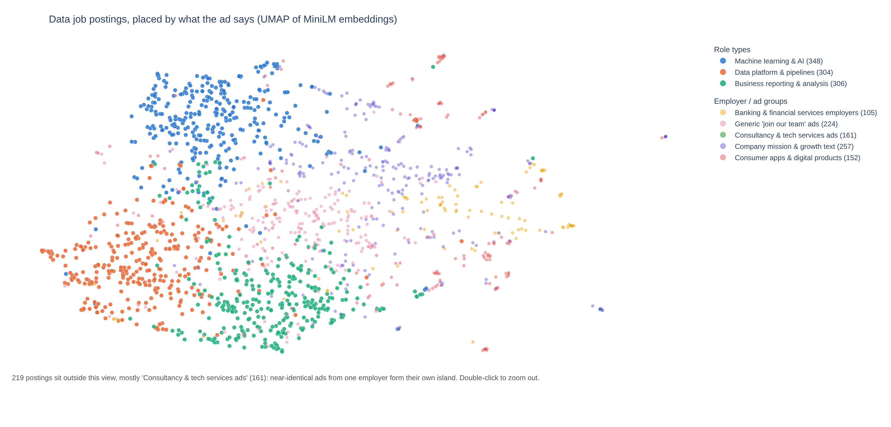

# Method in detail

Step-by-step notes for each stage of the pipeline: the commands, the rules
and the settings, with the reason for each. The [README](../README.md) tells
the story; this file is the reference behind it.

## 1. Collection (`src/collect.py`)

1. Get free API keys at https://developer.adzuna.com/ (sign up, then copy the
   App ID and App Key from your dashboard).
2. Set up the project:
   ```bash
   python -m venv .venv && source .venv/bin/activate
   pip install -r requirements.txt
   cp .env.example .env   # then paste your keys into .env
   ```
3. Collect postings:
   ```bash
   python -m src.collect                 # UK, 10 pages per search term
   python -m src.collect --country us --pages 5
   ```
   This writes `data/raw/adzuna_<country>_<date>.jsonl` (one posting per line)
   and a matching `.meta.json` describing the run.
4. Run the tests (no keys needed): `python -m pytest`

## 2. Cleaning (`src/clean.py`)

```bash
python -m src.clean                                      # newest raw snapshot
python -m src.clean data/raw/adzuna_gb_2026-10-24.jsonl  # a specific one
```

This writes `data/processed/postings_<country>_<date>.csv` (one row per job)
and a `.meta.json` with how many rows each step removed. The UK snapshot of
2026-10-24 goes from 2,454 raw rows to 2,262 unique ids to 1,995 jobs, of
which 1,857 are in scope (data roles that aren't training-course ads).

Cleaning rules (all defined at the top of `src/clean.py`):

| Step | Rule | Why |
|---|---|---|
| Same id | One row per Adzuna id; `search_terms` lists every term that found it | A job can match several searches |
| Reposts | Same title + company + description = one job; `n_locations` counts the places it was posted | Some advertisers post one ad in many towns |
| Not on description alone | Different titles at one company are kept apart | Descriptions are 500-char snippets that often start with company boilerplate |
| Text | HTML tags, entities and zero-width characters removed | Clean input for skill matching |
| `title_clean` | Lowercase; ML/BI/Sr written out; brackets, " - extra text", work-mode words and codes removed | Make titles comparable |
| `seniority` | First matching keyword: intern, entry, junior, head, manager, principal, staff, lead, senior, else unspecified | Separates level from role |
| `title_family` | First matching rule: analytics engineer, ML engineer, AI engineer, data engineer, data scientist, BI analyst, data analyst, else other | The "official title" the clusters are compared against |
| Salary | Advertised salaries go in `salary_min/max/mid`; Adzuna's own predictions (about 60%) go in `salary_estimate`; advertised values under £10k (day or hourly rates) are dropped; nothing is imputed | Keep real figures separate from a model's guesses |
| Flags | `is_data_role` (title names a data role), `is_training_ad` (trainee / placement-programme course ads) | Rows are flagged, not deleted, so later steps choose |

## 3. Skill extraction (`src/skills.py`)

```bash
python -m src.skills                                          # newest cleaned file
python -m src.skills data/processed/postings_gb_2026-10-24.csv
```

This writes three files to `data/processed/`:

- `skills_<country>_<date>.csv`: one row per posting and skill found, with
  `in_title`, `in_description` and the exact `matched_text`, so every match
  can be checked by eye.
- `skill_frequency_<country>_<date>.csv`: one row per skill: how many in-scope
  postings mention it, the share overall, and the share within each title family.
- `skills_<country>_<date>.meta.json`: coverage numbers, including how many
  postings have no skills at all.

How matching works (dictionary and rules at the top of `src/skills.py`):

| Rule | Example | Why |
|---|---|---|
| Curated dictionary of 99 skills in 10 categories, each with synonyms | `scikit-learn`: "scikit-learn", "sklearn" | Transparent and easy to change, unlike a learned extractor |
| Whole words only | "scala" does not match "scalable" | Avoid matches inside other words |
| Spaces and hyphens are interchangeable | "power bi" matches "Power-BI" and "PowerBI" | Ads write tool names inconsistently |
| Case ignored, except short words that are also ordinary English | "Excel" but not "excel in this role"; "SAS", "SAP", "Fabric" | Fewer false matches |
| Special rules for "R" and "RAG" | "Python or R" counts; "R&D", "A&R", "R-2079" do not; "RAG status" (red/amber/green) does not | A single letter needs its own rule |
| "Go" only as "Golang" | "ready to go live" does not count | "Go" is nearly always the verb |
| Frequencies count descriptions only | "Machine Learning Engineer" in a title is not the skill "machine learning" | Titles are what clusters get compared with later, so counting them would be circular |

**Sparsity.** Adzuna descriptions are 500-character snippets that often open
with company boilerplate, so many postings mention no skill. In the UK
snapshot of 2026-10-24, 1,070 of the 1,857 in-scope postings (58%) have no
skill in their description (947 if titles are also searched). Postings that
do mention skills have between 1 and 15.

## 4. Features and clustering (`src/embed.py`, `src/cluster.py`)

```bash
python -m src.embed                 # features for every text version (TF-IDF + sentence embeddings)
python -m src.cluster compare       # score K-means and HDBSCAN on every feature set
python -m src.cluster final features_<...>.npz --kmeans 8   # once a setting is chosen
```

The clusters are built from the description with **role names masked and
employer boilerplate removed** (`--text masked`), so they come from what the
ad says about the work rather than from the job title they will be compared
with. The unmasked versions are kept for comparison. Sentence embeddings need
the model downloaded from huggingface.co.

Final setting: MiniLM (`all-MiniLM-L6-v2`) embeddings of the masked text,
K-means with k=8 and seed 42. The comparison behind that choice (3 feature
types x 3 text versions, K-means k=3 to 12, HDBSCAN at four
`min_cluster_size` values) is in
`data/processed/cluster_comparison_<country>_<date>.csv`, and the README's
Method section summarises why.

## 5. Cluster map (`src/projection.py`)

```bash
python -m src.projection             # writes data/processed/projection_<country>_<date>.csv
python -m src.projection --preview   # also writes an interactive HTML map to open in a browser
```



The clusters are found in the full 384-dimensional embedding space; this step
only squeezes the same embeddings into 2D with UMAP so they can be drawn, and
never changes a label. It runs offline so the app only has to read a small CSV.

Settings and why:

| Setting | Value | Why |
|---|---|---|
| `n_neighbors` | 30 | Compared 15, 30 and 50. 30 keeps clusters a little cleaner on the map (neighbour cluster agreement 0.72 vs 0.69 at 15) for a small loss of trustworthiness (0.87 vs 0.88). |
| `min_dist` | 0.1 | 0.3 spread points out but lowered trustworthiness at every `n_neighbors` (0.84 to 0.85). 0 is for clustering, not drawing: points pile on top of each other. |
| `metric` | cosine | Same distance as everywhere else for embeddings. |
| `init` | pca | UMAP's default start ("spectral") gave a different map on every run even with a fixed seed (umap-learn 0.5.12, SciPy 1.18). PCA start is reproducible. |
| `random_state` | 42 | Same seed as the rest of the project. |

How to read the map:

- The three role types sit apart: ML & AI at the top, data platform & pipelines
  bottom left, reporting & analysis bottom middle. The employer / ad-template
  groups spread across the right half, between and around them.
- Distances between far-apart groups mean little; UMAP keeps who sits next to
  whom, not global distances.
- A few employers post near-identical ads (one recruiter's template, the same
  company blurb on every job). Each forms a tight island away from the rest.
  The map opens zoomed on the main body and says how many postings are outside;
  double-click to zoom out.
- Quality (in `projection_<country>_<date>.meta.json`): trustworthiness 0.87
  (of each posting's 10 nearest map neighbours, how many were also near it in
  384-d), and on average 72% of a posting's 10 map neighbours share its cluster,
  about the same as in 384-d (71%), so the map does not exaggerate how
  separate the clusters are.

## 6. The app (`app/`, `src/match.py`)

```bash
streamlit run app/streamlit_app.py
```

The app only reads the precomputed files in `data/processed/` (newest
snapshot); it never re-embeds the ads or runs UMAP, starts in seconds, and
loads one small model (MiniLM, ~90 MB), and only on the Match me page.
`app/requirements.txt` lists just what it needs.

| Page | What it shows |
|---|---|
| Market overview | Headline numbers, most-asked-for skills, ads by title and seniority, advertised salaries by title, regions; filter by job title |
| Cluster map | The milestone 5 UMAP map, filterable by job title and role type; drag a box or lasso to list the ads |
| Cluster profiles | One cluster at a time (skills, job titles, salary, the ads themselves), then a heatmap of where each job title's ads ended up |
| Match me | Paste skills or a CV, or upload a PDF CV; get the closest role type and the skills to add |

How "match me" works (`src/match.py`): a hybrid. The language model picks
the role, and the skill dictionary says what is missing.

1. Input is pasted text or a PDF CV (text read with `pypdf`; scanned PDFs
   with no text layer are not supported).
2. Closest role: role names are blanked out of the text (as in the ads), the
   text is cut into ~500-character pieces (MiniLM reads at most 256 word
   pieces), each piece is embedded with MiniLM, and the pieces are averaged.
   The closest of the three role-type centres (mean ad embedding, cosine
   similarity) is the match; if the top two are within 0.03 it is reported
   as a close call.
3. Skills found: the same dictionary as the ads (`src/skills.py`).
4. Skills to add: the matched role's profile skills (named by at least 2% of
   its ads, counting only ads in the role's own cluster) that the text does
   not mention, most asked-for first.

Only the three role types are matched: the other five clusters group ads by
employer, so matching to them says nothing about your work. The app embeds
only the visitor's text; the ads were embedded offline. `app/requirements.txt`
pulls the CPU-only build of torch to keep the deployed app small.
